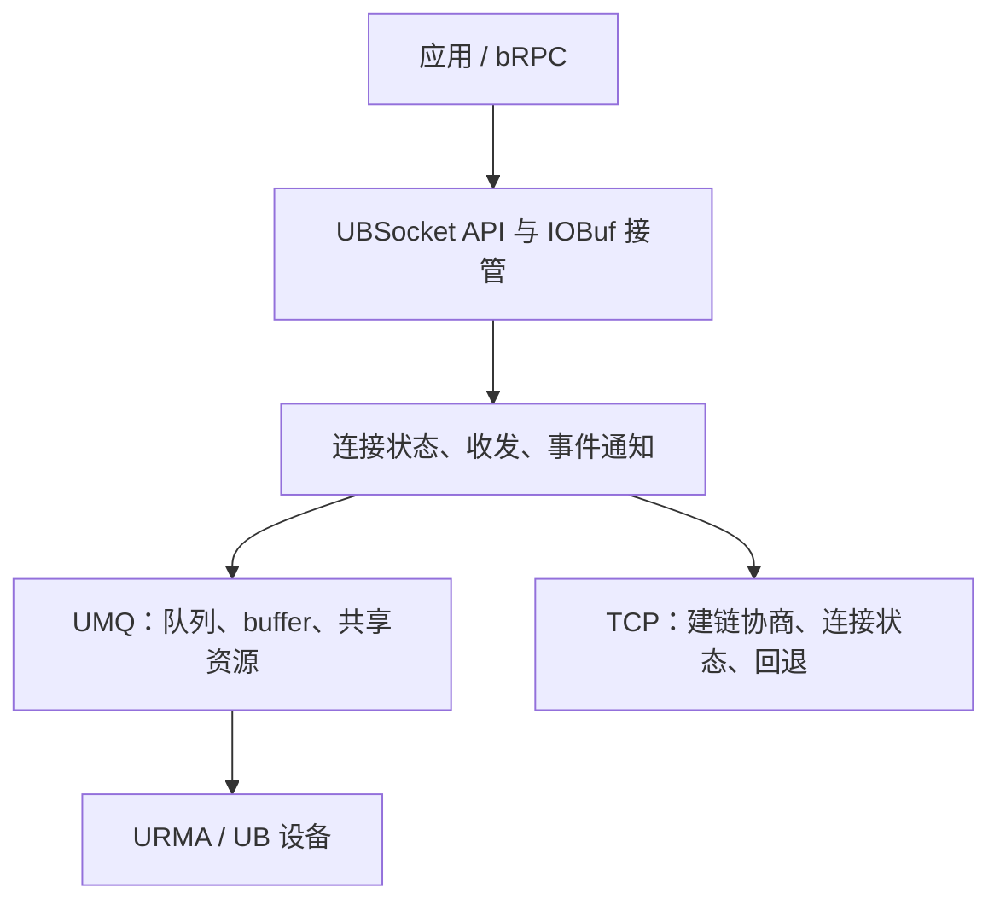
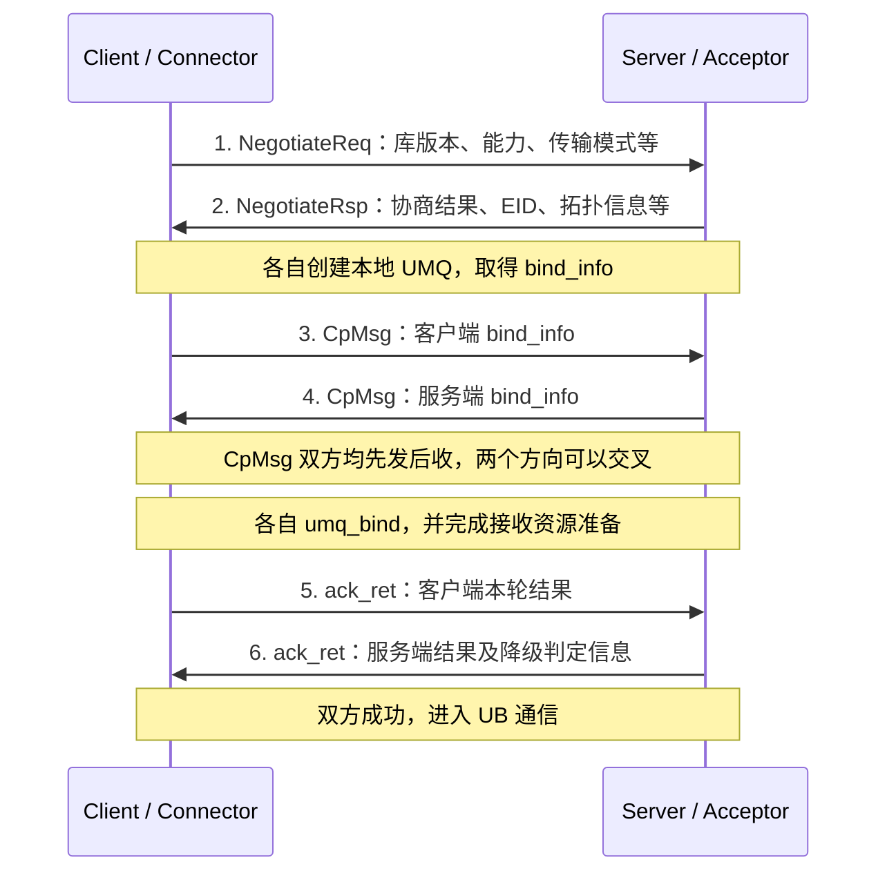
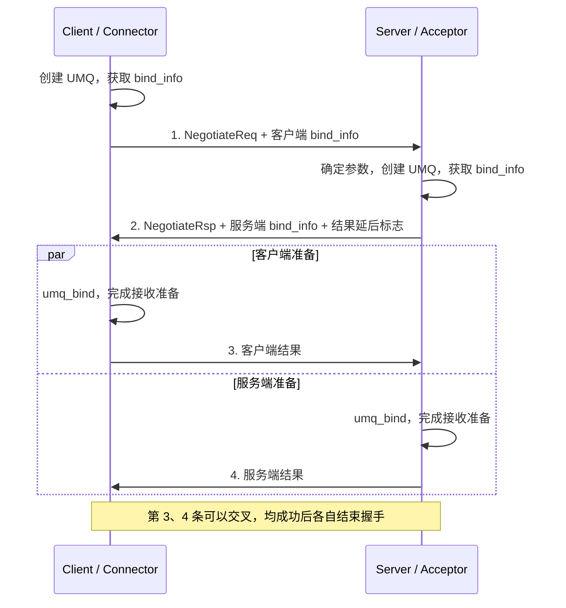
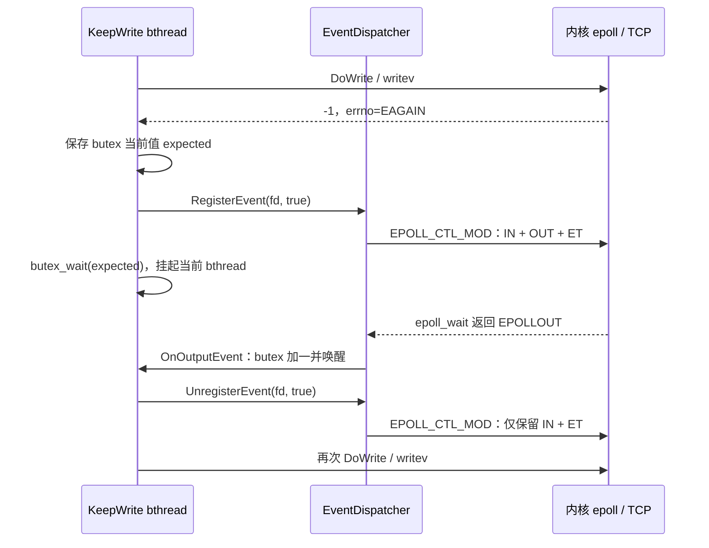
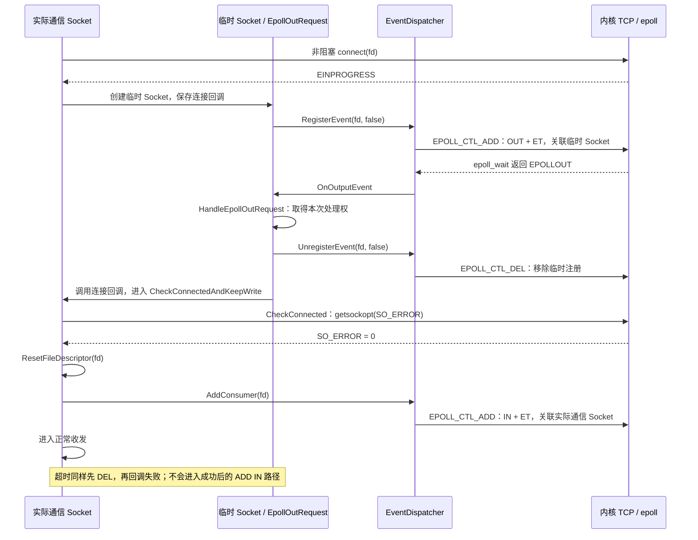
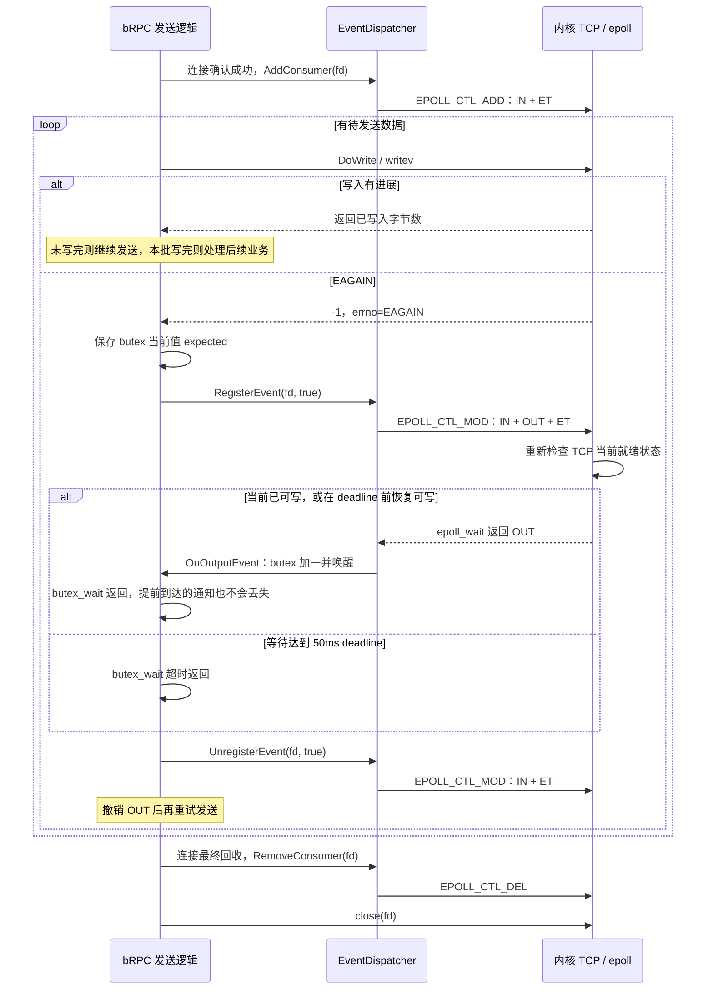
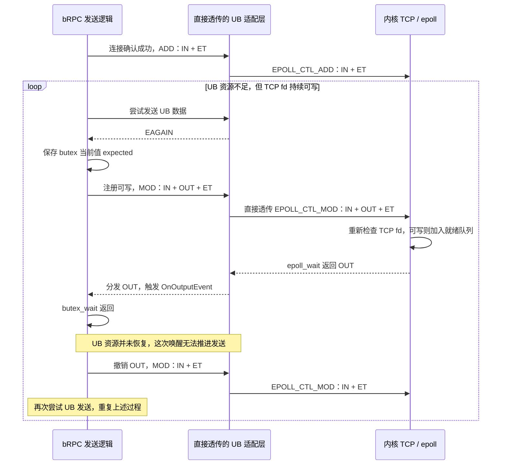
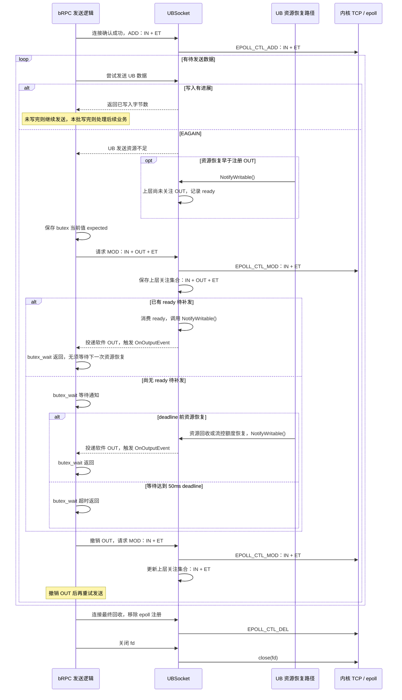
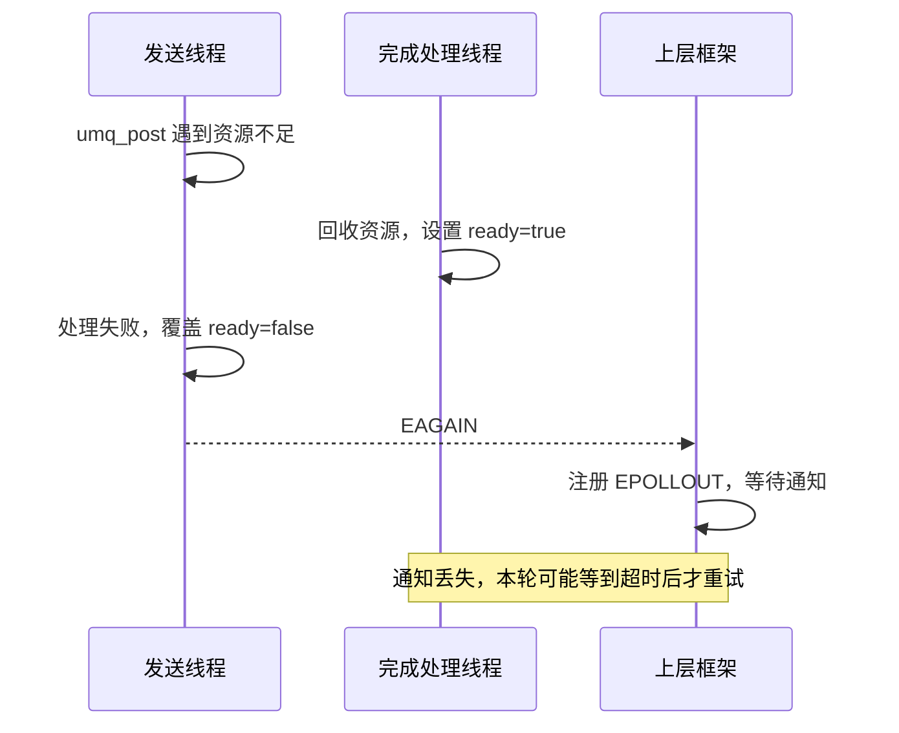

* content
{:toc}

# ubsocket

ubsocket 的源码位于 [openEuler 的 ubs-comm 仓库](https://atomgit.com/openeuler/ubs-comm)。最值得说的一点是：当通信从内核 TCP 转移到用户态 UB 传输之后，原本由内核维护的连接状态、资源回收和事件通知，需要由通信库重新组织，并且让上层框架仍然能够正确运行。

这篇文章从我的相关提交出发，解释期间遇到的问题、它们为什么会出现，以及如果要重新设计时 [kbsocket](https://github.com/condy0919/kbsocket) 应该怎样减少避免。

## 我对项目的理解

ubsocket 面向 socket 风格的应用提供 UB 通信能力，brpc 是其中一个重要的集成场景。在这个仓库中，ubsocket 位于 `src/ubsocket`，其使用的 UMQ 位于 `src/hcom/umq`。

上层使用对外的 socket、epoll 和 buffer 接口，中间维护连接与收发状态，下层通过 UMQ 使用 UB 传输资源。UMQ 内部再与 URMA 等底层能力对接。



整个项目主要有以下几部分:

1. **如何建立连接** 双方通过 TCP 进行能力协商、交换 UB 信息、创建 UB 资源。
2. **如何推进数据传输** 发送提交、硬件执行、完成队列产生 CQE、软件处理 CQE.`post` 成功不等于应用可以立即释放所有相关内存，也不等于对端应用已经消费数据。
3. **如何向应用报告进展** UB 上的完成事件需要转换成上层可理解的可读、可写或失败通知。返回 `EAGAIN` 之后，必须还有一个能够推动重试的来源。
4. **谁持有资源，何时归还** 普通收发、共享队列、IOBuf 接管和单边 READ 的生命周期不同。CPU 不再使用某个对象，不代表硬件已经不再访问它。

这些责任彼此相连，也是下面几类问题反复出现的原因。

## 建链

### 建链之 UB 握手

这里需要区分 TCP 建链与 UB 握手。TCP 提供控制通道，UB 握手在这个通道上进行能力协商、交换资源信息。在本文重点讨论的 jetty 池和共享接收路径中，每条连接有自己的逻辑 UMQ，多条连接可以共享底层接收资源。`bind_info` 是双方交换的 UMQ 绑定信息，其中包含本地 jetty 的描述 `rjetty`；对端将收到的 `rjetty` 导入为本进程中的 target，之后发送时通过这个 target 指定目标。交换的是描述信息，target 则是 import 后在本地得到的对象。

```c++
// client
rjetty = urma_get_rjetty();
send_rjetty_to_server(rjetty);

// server
recv_rjetty_from_client(rjetty);
tjetty = urma_import_jetty(rjetty);
```

下面先看经典流程，再看优化之后建链成功时的流程图。图中的箭头表示逻辑消息，不对应固定数量的 TCP 报文。

#### 最经典的路径：先协商，再交换资源，最后确认结果

下图展示的是最经典的 UB 建链流程图，省略了 TCP 本身的建链，以及 UB 建链失败后的换路重试。



这里的 ACK 是 ubsocket 控制协议中的结果通知，与 TCP 报文头的 ACK 标志没有直接关系。它确认的也不只是 `umq_bind` 返回值，还包括本轮必要的接收队列预填充等准备工作。下文用 READY 表示本端准备成功；除了 import 完成，接收 buffer、软件接收映射等也必须就绪，才能声明可以接收对端数据。

#### 当前优化后的路径

在支持 jetty 池的路径上，双方将 `bind_info` 都携带到发给对端的首个 TCP 协商包中，并且并行 `umq_bind` 可以省去独立的 `CpMsg` 交换。当前这些优化全部生效时，首轮成功流程如下：

1. **Connector 提前创建本地 UMQ。** 在发送协商请求之前，调用 `umq_bind_info_get()` 获取本端 `bind_info`，随 `NegotiateReq` 一起发送给 Acceptor。
2. **Acceptor 在协商应答中返回自己的绑定信息。** 收到请求后，确定传输参数，创建本地 UMQ 并取得 `bind_info`，随 `NegotiateRsp` 返回。启用并行 bind 时，先发送应答，再执行本端 bind。
3. **双方并行完成绑定与接收准备。** 此时双方都已拿到对端的 `bind_info`，可以各自调用 `umq_bind()`，并完成必要的接收队列预填充等工作。
4. **双方交换准备结果。** 各自先发送本端结果，再接收对端结果；双方均成功后结束握手，进入 UB 通信。



这条路径将 `bind_info` 交换合并进了协商过程，同时让两端 `umq_bind` 重叠执行。

若服务端在发送协商应答前就完成 `umq_bind` 和接收准备，也可以把结果放进应答包内，最后只由客户端发送确认，形成三条逻辑消息；不过两端 `umq_bind` 就会串行执行，消息更少未必耗时更短。

在 `RM_CTP` 路径中，`umq_bind` 只会调用 `urma_import_jetty`，不需要 RC 模式的 `urma_bind_jetty`。可以认为在正常情况下 `urma_import_jetty` **平均**只有 10us 的耗时。以约 20us 的同机房 TCP RTT 作比较，`urma_import_jetty` 与 TCP 小包传输耗时差不多。~~但是我感觉 `urma_import_jetty` 在高并发下性能会变得更差~~

#### 怎么才能做得更好一点

我之前倾向于把 UB 握手也整理成三条消息，过于看重消息数量，认为 `urma_import_jetty` 耗时不会太大。而且本来以为可以使用 `urma_import_jetty_async` 接口来达到极致建链性能，但现场检查实际 udma context 的 ops 表后，发现当前 raw UDMA provider 没有注册异步 import 及配套 notifier 回调。卒...

现在更合适的做法是：**尽早交换 jetty 描述符，两端独立准备，完成后立即发送各自的结果。** 本地描述符来自已经创建的 jetty，可以通过 `urma_get_rjetty` 取得，目前 ubsocket 也是这样做的。

拿一个简化的模型看一下区别：从服务端收到请求开始计时，控制通道单程延迟为 `d`，两端 import 分别耗时 `Ls`、`Lc`，忽略其他准备成本，客户端完成双向就绪确认的时间为：

```text
方案1: 服务端 import 完成才回复：Ls + d + Lc
方案2: 先回复描述符、双方并行 import、结果交叉发送：max(Ls, Lc) + d
```

例如假设两端 import 都为 10us、`d=10us`，这段时间分别是 30us 和 20us。

在共享接收路径下，多条逻辑 UMQ 交换的可能是同一个主队列 Jetty 的描述，背后复用共享 JFR。因此，同一对进程建立多条连接时，可以考虑复用导入后的 target，并把相同目标的并发导入合并成一次。

目前分析下来，在当前基础上还可以再做以下几点优化：

1. **复用导入结果，减少真正的 import。** 为可共享的远端 rjetty 缓存 target；相同 rjetty 缓存未命中的并发合并成一次导入，其余连接等待结果。缓存至少区分本地 context、远端 endpoint generation. 本地 jetty 池、底层 CTP 复用和 target 缓存是三件事，前两者不自动免除 import 调用。
   - 如果服务端命中仍然有效的 target 缓存，而且接收资源和软件接收映射都已就绪，就可以在返回本地描述符时一并携带 READY，无需再单独发送结果消息。在前面的简化模型中，服务端缓存命中意味着 `Ls≈0`，三条消息与结果交叉发送的四条消息都约为 `d + Lc`，剩余等待由客户端 import 决定（客户端本身也有缓存）。缓存 target 减少了底层 `urma_import_jetty` 工作及其争用；合并 READY 则可以减少控制消息和处理开销，虽然在这个的耗时上可能与 4 条消息的流程差不多，不过仍旧可以尝试一下。
2. **专用的建链线程。** 当前 ubsocket 已有异步 accept 处理路径，进一步可以统一 Acceptor 和 Connector 的建链执行机制。双方先发送本地描述符，再在各自的建链线程中就地执行同步 import，就能实现两端并行，不必为了并行而将每次 import 再转交另一个线程。

此外另有一个必须要提及，**控制消息走 TCP，业务数据走 UB，两条通道之间没有统一的到达顺序。** 先发 TCP READY 再发 UB 首包，不保证服务端先处理 READY；接收映射应提前发布，早到的首包可以有界暂存，满足会话确认条件后再交付。

> 当前 ubsocket 已有类似问题的修复：`aa6049a5` 将 fd 到 socket 的注册提前到协商之前，避免服务端尚在等客户端 ACK 时，共享 JFR 收到首包却查不到 socket。

这一点与下一章节提及的 epoll 相关内容相关。

## EAGAIN 之后：怎样保证连接还能继续推进

### 原生 brpc 什么时候关注 EPOLLOUT

brpc 的普通 TCP 对于已经注册读回调的 RPC 连接，`ResetFileDescriptor()` 通过 `AddConsumer()` 注册 `EPOLLIN | EPOLLET`，平时不关注 `EPOLLOUT`。发送时直接尝试写，只有写不动时才临时等待可写。

具体来说，`Socket::StartWrite()` 通常先在调用线程尝试写一次。如果没有写完，就创建一个新的 bthread 进行 `Socket::KeepWrite()`。`KeepWrite()` 会先调用 `DoWrite()` 继续发送；正数返回值表示有进展，即使只是部分写入，也不立即等待可写。对于没有按致命错误退出、且本次 `nw <= 0` 的情况，才调用 `WaitEpollOut()`；普通 TCP 最典型的就是 `writev()` 返回 `-1`、`errno == EAGAIN`。

`WaitEpollOut()` 的调用链是：

```text
Socket::KeepWrite()
  -> Socket::WaitEpollOut(fd, pollin, deadline)
     -> _io_event.RegisterEvent(fd, pollin)
        -> EventDispatcher::RegisterEvent(...)
           -> epoll_ctl(...)
     -> butex_wait(...)
     -> _io_event.UnregisterEvent(fd, pollin)
        -> EventDispatcher::UnregisterEvent(...)
           -> epoll_ctl(...)
  -> 再次尝试 DoWrite()
```

这里 `pollin` bool 值来自 `_on_edge_triggered_events != NULL`，表示这条连接还需要保留读监听。对于这样的连接，注册可写实际执行的是 `EPOLL_CTL_MOD`，把关注集合改为 `EPOLLIN | EPOLLOUT | EPOLLET`.



`EventDispatcher::Run()` 收到 `EPOLLOUT` 后，通过 `output_cb` 调用 `Socket::OnOutputEvent()`，增加 `_epollout_butex` 的值并唤醒等待者，真正的发送仍由恢复的 `KeepWrite()` 完成。`WaitEpollOut()` 会在注册事件前保存 butex 值。如果事件先于 `butex_wait()` 到达，回调已经改变这个值，等待操作就不会再按旧值睡下去。普通 bthread 在这里挂起时，worker 可以继续执行其他 bthread。

这次等待还设置了 **50ms 的 deadline**。超时后 `KeepWrite()` 会继续检查待发送请求、推进发送，而不是仅凭这次等待超时就判定连接失败；代码这样做也为了定期检查积压请求和拥塞状态。因此，丢失一次可写通知可能表现为等待到超时后的重试和长尾，并不必然永久卡住。

**`WaitEpollOut()` 从 `butex_wait()` 返回后就调用 `UnregisterEvent()`，之后才回到发送循环；它不会等数据全部写完再取消。** 被事件唤醒和等待超时都会走这一步。

另外，如果一个新的 `Socket` 刚准备写，这时它会进行非阻塞 TCP 建链，`connect()` 通常返回 `EINPROGRESS`，brpc 用携带 `EpollOutRequest` 的临时 `Socket` 注册 `pollin=false` 的 `EPOLLOUT` 等待事件。当可写或者超时后进入 `HandleEpollOutRequest()`，它会先调用 `UnregisterEvent(fd, false)` (内部调用 `EPOLL_CTL_DEL` 删除临时注册)，再执行连接回调。成功事件仍要通过 `CheckConnected()` 检查 `SO_ERROR`。连接确认成功后，实际通信 Socket 再注册自己的读监听。

下面画出 `connect()` 返回 `EINPROGRESS` 后的成功路径。临时 Socket 和实际通信 Socket 使用的是同一个 fd，删除临时 epoll 注册并不关闭 fd。图中的 IN、OUT、ET 分别表示 `EPOLLIN`、`EPOLLOUT`、`EPOLLET`，省略 `EPOLLRDHUP` 等其他标志。



### ubsocket 做了什么

原生 TCP 还有一层保证：通过 `EPOLL_CTL_MOD` 添加可写关注时，内核会重新检查当前 IO 就绪状态。因此，即使发送失败之后、注册可写之前 TCP 已经恢复可写，只要注册时仍然可写，也可以得到通知，不必等下一次状态变化。这个行为在 [epoll(7)](https://www.man7.org/linux/man-pages/man7/epoll.7.html) 中有说明。如果是第一次使用 `EPOLL_CTL_ADD` 来监听 `EPOLLOUT` 事件，同样也会进行这个检查。

从连接确认成功开始，一个普通 TCP 通信 Socket 的注册变化如下。图中只画正常发送和 `EAGAIN`，省略致命错误处理；等待结束后先撤销 OUT，再重试发送。



但是换成 UB 数据面之后，**TCP fd 可写与 UB 发送资源可用是两回事**。如果直接把控制通道的 TCP `EPOLLOUT` 当成 UB 可写通知，就可能反复出现 “被唤醒 → UB 发送仍然 `EAGAIN` → 再次注册 → 又因 TCP 可写被唤醒” 的循环。

假设直接透传 brpc 请求的关注集合，并且 UB 发送资源一直不足、TCP fd 却持续可写，就会形成下面的循环。每轮重新执行 MOD 都会检查 TCP 状态，因此使用 ET 也不能避免这种无效唤醒。



所以，ubsocket 的 `AsyncEventPoll::EpollCtlMod()` 会保存上层请求的关注集合，同时去掉实际 TCP fd 的 `EPOLLOUT` 监听；UB 的可写事件由资源恢复路径调用 `NotifyWritable()` 产生。如果恢复发生时 brpc 还没有关注 `EPOLLOUT`，就先记住这个状态，等后续 `EpollCtlMod()` 注册可写时补发通知。

修复后，上层关注集合与实际 TCP fd 的关注集合分开维护。下面仍从已建立的连接开始，图中的 OUT 通知由 ubsocket 投递给 brpc，不来自 TCP fd 的可写状态。



如果资源恢复早于上层注册 OUT，`NotifyWritable()` 会先记录 ready，之后 MOD 时补发；如果恢复发生在等待期间，则直接通知。实际投递可以走已注册的直接分发回调，也可以通过用户态事件队列和内部 eventfd 唤醒等待者，两种方式都不需要监听 TCP 的 OUT。

### NotifyWritable 为什么仍然会丢 EPOLLOUT 通知

一个有问题的时序是这样的：发送线程的 `umq_post` 因资源不足失败；在它处理失败之前，完成线程已经回收资源并设置可写；随后发送线程无条件写入 `writable_ready = false`，覆盖了刚到达的通知。



这些读写即使都是原子的，也只能保证单次访问不被拆开，不能保证一个较旧的失败结果不会覆盖较新的资源恢复事件。

修复把状态扩展成“版本号 + ready 位”。发送之前保存快照；可写通知到达时增加版本；失败路径只有在版本仍未变化时，才能通过 CAS 清除 ready。若 CAS 失败，就保留期间到达的通知，供后续 `EpollCtlMod` 补发事件。

这里版本号想要表达：“从我开始尝试发送到现在，底层 jetty 是否已经收到可写通知了？” 这是单个 bool 无法表达的信息。

## 从 ubsocket 到 kbsocket

做这些工作之前，我更多关注一次发送要经过多少层调用、一次握手需要交换多少条消息。现在我会先问：哪些工作必须串行完成，哪些可以重叠；一次操作暂时无法继续时，谁负责让它重新推进；状态发生变化后，谁负责保存并通知上层。

建链优化让我意识到，消息数量并不能直接代表首包时延。ubsocket 当前提前交换 `bind_info`、两端并行准备的方案，已经缩短了这条路径。继续做 kbsocket 时，我希望保留这个思路，进一步减少重复 import，并在接收资源和连接映射真正就绪后再声明 READY。是否合并结果消息、是否引入额外线程，都应该用首包时延和高并发下的排队成本来判断。

`EAGAIN` 的问题则让我重新理解了 socket 兼容需要承担的责任。内核在 ADD、MOD 时检查当前就绪状态；换成 UB 数据面后，通信库也需要处理“资源先恢复、应用后注册”的情况。对 kbsocket 来说，返回 `EAGAIN` 时就应明确后续由哪条资源回收或流控路径推动重试，让可写状态的记录、关注事件的注册和通知投递能够衔接起来。可写通知只表示值得再次尝试，重试时仍然需要处理 `EAGAIN`。

这也影响了 kbsocket 的并发设计：计划由固定的 owner 线程统一推进所属物理队列的收发和完成处理，让资源回收、额度更新与连接状态变化有明确的归属；其他线程通过提交队列与它交互。跨线程提交仍有开销，应用注册事件与 owner 发布状态之间也仍需处理竞态，但明确所有权可以减少需要同时修改同一份状态的参与者。核心传输层负责维护这些状态，socket 兼容层再将它们转换成上层理解的可读、可写和失败事件。

接下来在 kbsocket 中，我想沿着这些边界逐步实现和验证：从建链到首包，检查准备工作的依赖和耗时；从发送失败到资源恢复，检查连接能否继续推进；从提交 WR 到完成或故障清理，检查资源是否能安全归还。这些是后续工作的设计和验证方向，性能收益还需要通过实际测量来确认。
